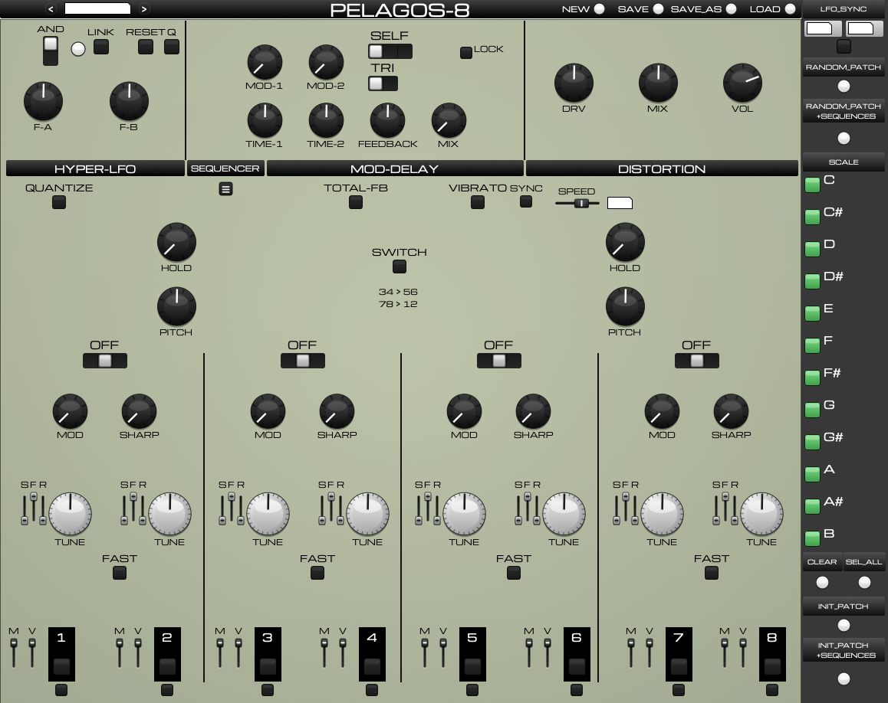
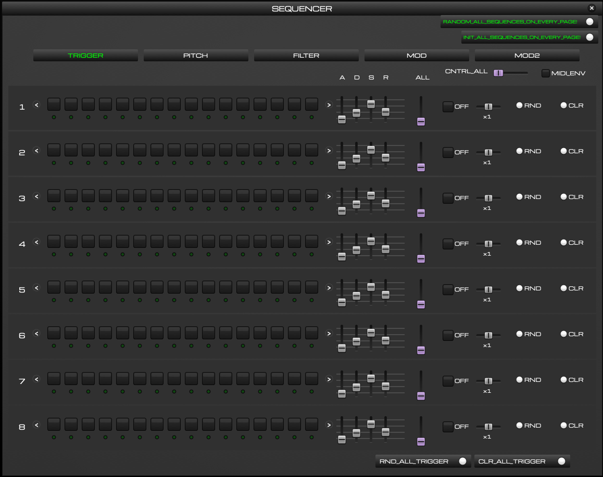
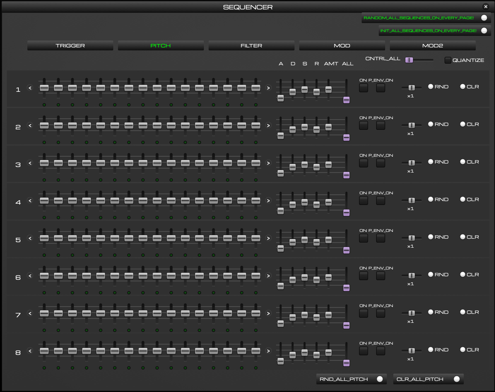

# Pelagos-8

Pelagos-8 is an 8-voice drone/percussive synthesizer plugin (VST3) with a
five-page step sequencer (triggers, quantized pitch, filter, and two
modulation lanes), per-voice envelopes and outputs, scale quantization,
preset management, and a custom hardware-style interface.

It began as a heavily extended derivative of
[LIRA-8 by Mike Moreno DSP](https://github.com/MikeMorenoDSP/LIRA-8)
(BSD license — see [License.txt](License.txt)), a Pure Data emulation
inspired by the SOMA Laboratory Lyra-8. Pelagos-8 is not affiliated with,
and does not represent, SOMA Laboratory or Mike Moreno DSP.

## Download and install

Get the zip for your system from the
[Releases page](https://github.com/timhastie/Drone8/releases), unzip it and
double-click the installer inside. The
[manual](docs/Pelagos-8_Manual.pdf) starts with the install steps, including
the security prompts macOS and Windows show for an unsigned plugin.

- macOS 12 or newer, Apple Silicon and Intel: tested.
- Windows 10/11 64-bit and Linux 64-bit: built automatically by CI, less
  tested. Please report problems in
  [Issues](https://github.com/timhastie/Drone8/issues).

## The sequencer

Five pages drive the eight voices: triggers with per-lane envelopes,
scale-quantized pitch, filter, and two modulation lanes — each with per-lane
clock multipliers, step shifting, randomize/clear, and ALL macro sliders for
ping-to-drone envelope morphing.

## Structure

- `Pelagos-8_Plugin/Pelagos-8/` — the Pd patch, plugin config, and abstractions
- `tools/` — the patch generator (`generate_sequencer.py` regenerates
  `Pelagos-8.pd` from `base.pd`), deploy and Windows packaging scripts
- `engine/` — the custom-editor fork of [Camomile](https://github.com/pierreguillot/Camomile)
  (GPLv3), reproduced via `engine/fetch_camomile.sh` + `engine/patches/`
- Original upstream LIRA-8 distribution folders are retained unmodified for
  attribution and reference.

## Credits

- DSP foundation: Mike Moreno DSP (LIRA-8, BSD license)
- Plugin engine: Camomile by Pierre Guillot (GPLv3), Pure Data by Miller
  Puckette and contributors (BSD)
- UI typeface: Michroma (SIL Open Font License)
- Inspired by the SOMA Laboratory Lyra-8
